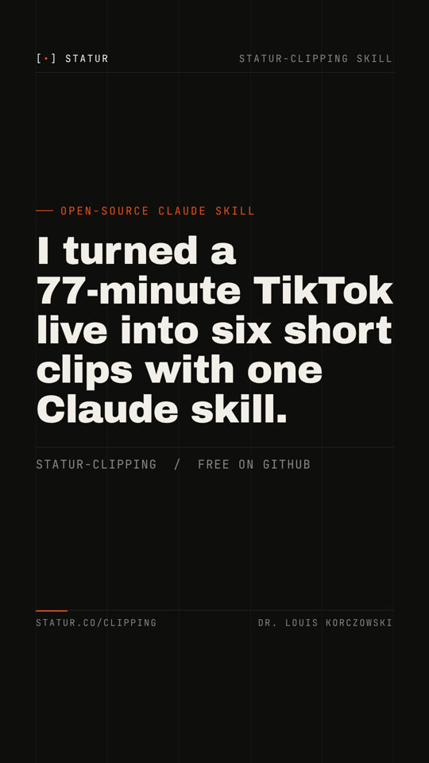

# STATUR clipping

Turn a live, a webinar, a long video or a folder of recordings into ready-to-post vertical clips, in French or English, with an AI agent and free local tools.

- Page (human version, source of truth): https://statur.co/clipping/
- Markdown for AI assistants: https://statur.co/clipping.md
- The story behind it (essay on louis-korczowski.org): coming soon
- Demo (34 s, no sound): [docs/media/statur-clipping-demo.mp4](../docs/media/statur-clipping-demo.mp4), second run on a 77-minute live in French, six clips with English captions
- Version 1.4, 2026-11-03 (page); skills statur-clipping 2.5.0, statur-clip-plan 2.2.0, statur-clip-edit 2.4.0, statur-clip-review 2.2.0 (2026-11-13)

## Summary

Get the file: your own recording first, then the platform's replay download, a long YouTube video of your own, a Google Drive file or a whole Drive folder. Transcribe it on your computer with word timestamps (NVIDIA Parakeet v3 through sherpa-onnx, no GPU, no API key), and check that the transcript lines up with the video before any cut. Read the whole transcript with your AI, map the topics, stitch scattered answers, apply hard gates and score every candidate of 60 seconds or more. Write each edit as a short spec and render it where the footage lives, at any length and up to 4K, with word-by-word captions, a one-sentence hook and a small moving watermark. Transcribe every clip again to catch bad cuts. Review on a private page with notes at the exact frame, render the next version, and file the masters with one naming rule. The agent prepares drafts and never posts.

Built from a real run on a 1:40 TikTok live of October 24, 2026: 17 clip candidates (14 scored), 10 clips of one to two minutes. Second run, October 25, 2026: a 1:17 live in French, 13,480 words transcribed on a CPU in about 9 minutes, 16 candidates scored, 6 clips with English captions.

## Skills

| Skill | Use it for |
|---|---|
| [statur-clipping](../skills/statur-clipping/) | The whole chain for one recording, a batch or a mix: permissions, sources (lives, calls, Loom, YouTube, Google Drive, local), install, transcription, sync check, queue, layouts, watermark, delivery and the weekly routine. Holds every script. |
| [statur-clip-plan](../skills/statur-clip-plan/) | Read the full transcript, map the topics, score every candidate with the hard gates and six scores, write the edit spec. |
| [statur-clip-edit](../skills/statur-clip-edit/) | Render a spec, from one recording or a mix, into a master, a review copy and an upload copy: cuts, captions, hook, labels, layouts, watermark, loudness, then the quality check. |
| [statur-clip-review](../skills/statur-clip-review/) | Review page with timecoded notes, verdicts and plan votes, as a Claude artifact or a local page, and the loop to the next version. |

## Credit

Speech recognition: NVIDIA Parakeet TDT 0.6B v3 and Silero VAD, run through sherpa-onnx (k2-fsa). Rendering: ffmpeg and libass. Caption font: the one named in your brand tokens file ([docs/BRAND-TOKENS.md](../docs/BRAND-TOKENS.md)); neutral default Atkinson Hyperlegible (Braille Institute, SIL Open Font License).
